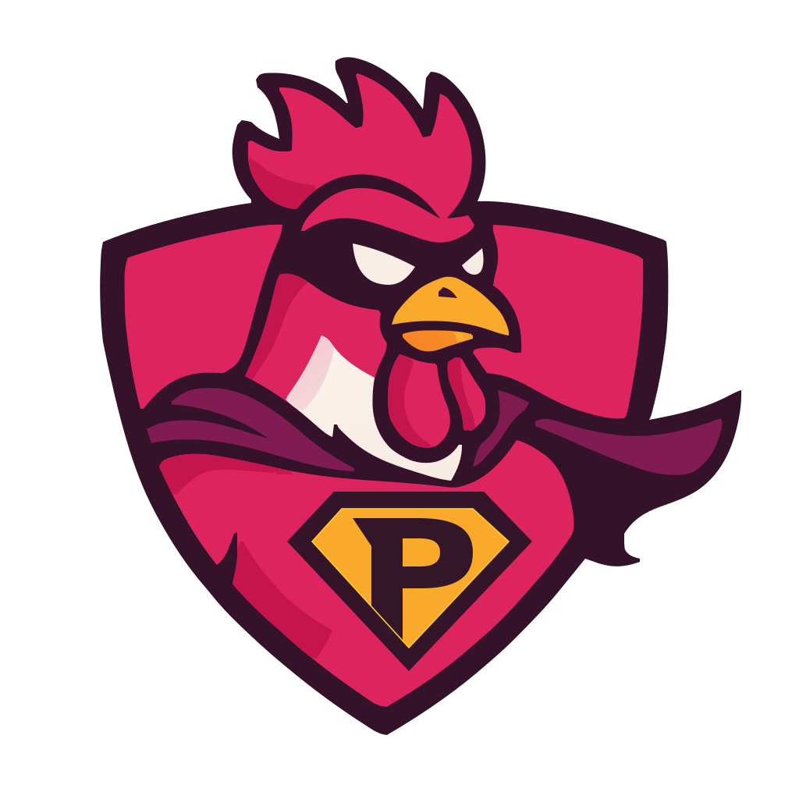

<div align="center">



# PinkRooster Terminal UX

**One portable agent skill that designs, builds and audits terminal interfaces (command-line output, interactive prompts and full-screen TUIs) to a high UX standard, in whatever language and framework your project already uses.**

[](LICENSE)
[](https://agentskills.io/specification)
[](#development)

[The idea](#the-idea) · [Install](#install) · [Usage](#usage) · [What's inside](#whats-inside) · [Compatibility](#compatibility) · [Development](#development)

</div>

---

## The idea

Coding agents write terminal UI that looks fine in a screenshot and breaks everywhere else:
spinners leak into piped output, colour ignores `NO_COLOR`, shortcuts are hidden, layouts
fall apart in an 80-column pane, Ctrl-C leaves the terminal broken, and errors say
"Something went wrong". `terminal-ux` makes the agent apply the rules that prevent this
while it writes the code, and audit existing interfaces against the same standard.

The skill is **opinionated about behaviour and restrained about looks**. Stream discipline,
graceful degradation (pipes, CI, no colour, narrow panes, no Unicode, screen readers), terminal
restoration, discoverable keys and actionable microcopy are firm rules. Aesthetics are not
imposed: the project's own look wins, and a project without one gets quiet, semantic defaults.
It is stack-agnostic: it states what the user must see and be able to do, never how to use a
particular UI library.

These are instructions an agent follows, not a library or a linter. Your harness supplies file
access, questions and shell commands. User instructions and project rules take precedence.

### When to Reach for It

| If your immediate situation is... | Mode | What you get |
|---|---|---|
| A new command, script output or prompt flow to build | Build | Working code in your stack, plus the UX choices and the checks to run by hand |
| A new full-screen screen, dashboard or picker | Build | A committed layout, keys with a legend, restoration on exit, a minimum-size message |
| A small fix: table alignment, an error message, a flag's help text | Build | The edit, made directly from your code's context, without questions |
| An existing tool whose terminal UX you want reviewed | Audit | Findings ordered by user harm, each with evidence and a fix; no code changed |

It stays out of headless work (cron jobs, pure argument parsing, libraries with no
human-facing output) and of web, desktop and mobile UI.

## Install

Choose your coding harness. Run shell commands in a terminal; start a fresh agent session
once installation finishes.

| Harness | Recommended installation |
|---|---|
| Claude Code | `claude plugin marketplace add pinkroosterai/PinkRoosterTerminalUx`, then `claude plugin install pinkrooster-terminal-ux@pinkrooster-terminal-ux` |
| Codex CLI | `codex plugin marketplace add pinkroosterai/PinkRoosterTerminalUx`, then `codex plugin add pinkrooster-terminal-ux@pinkrooster-terminal-ux` |
| Antigravity CLI | `agy plugin install https://github.com/pinkroosterai/PinkRoosterTerminalUx` |
| Pi | `pi install git:github.com/pinkroosterai/PinkRoosterTerminalUx` |
| Cursor, Gemini CLI, GitHub Copilot, OpenCode | `npx skills add pinkroosterai/PinkRoosterTerminalUx`, then select your harness |

The skills CLI needs Node.js 22.20 or later; add `-g` for a user-wide install and `--copy`
where symlinks are unavailable. Keep the whole `skills/terminal-ux/` directory, including
`references/`. Install using one method per harness to avoid a duplicate skill.

**Verify before starting:** ask your agent, "Is the terminal-ux skill installed? Read it and
summarise its two modes. Do not change any files." Expect a summary of build and audit mode.
This checks discovery and loading, not behaviour; `docs/testing.md` has four fresh-session
prompts that test behaviour.

## Usage

| Harness | Explicit invocation example |
|---|---|
| Claude Code, plugin | `/pinkrooster-terminal-ux:terminal-ux audit the output of src/cli.py` |
| Claude Code, standalone | `/terminal-ux audit the output of src/cli.py` |
| Codex CLI / IDE | `$terminal-ux audit the output of src/cli.py` |
| Pi | `/skill:terminal-ux audit the output of src/cli.py` |
| Antigravity | Use its skill selector or ask "Use the terminal-ux skill to audit src/cli.py" |
| Other skill-capable hosts | Ask for the skill by name; command syntax depends on the host |

Natural requests such as "add a progress bar to the import command" or "review this TUI's
keybindings" select the skill through its description. Selection is model-dependent;
explicit invocation helps when routing is ambiguous.

## What's Inside

A short [SKILL.md](skills/terminal-ux/SKILL.md) holds the workflow (classify the task, respect
existing conventions, commit to a direction, build, audit), ten principles, the terminal-slop
list and a routing table. The agent then reads only the references a task needs:

| Reference | Covers |
|---|---|
| [output-and-resilience](skills/terminal-ux/references/output-and-resilience.md) | stdout vs stderr, TTY and CI detection, colour switches, Ctrl-C, terminal restoration, exit codes, progress and redraw |
| [visual-style](skills/terminal-ux/references/visual-style.md) | colour roles, colour depth, light and dark backgrounds, attributes, glyph width, fallbacks, borders |
| [layout-and-interaction](skills/terminal-ux/references/layout-and-interaction.md) | inline vs full-screen, TUI layout, size and resize, keys, legends, mouse, paging, tables, diffs |
| [prompts-and-microcopy](skills/terminal-ux/references/prompts-and-microcopy.md) | prompts, validation, errors, success output, empty states, confirmations, help text |
| [accessibility](skills/terminal-ux/references/accessibility.md) | screen readers, colour and contrast, motion, linear output, the accessible mode |
| [audit-checklist](skills/terminal-ux/references/audit-checklist.md) | the pass/fail pre-delivery audit, terminal slop, the audit report format |

Rules come from published guidance (clig.dev, `NO_COLOR`, terminal specifications, CLI
writing guides and accessibility research); where the field is silent, a rule is labelled as
the skill's opinion.

---

## Compatibility

The common [Agent Skills format](https://agentskills.io/specification) makes the skill
portable; it does not standardise tool APIs, permissions or command syntax. Version 0.1.0
was dogfooded in Claude Code and its installation checked in Codex, Antigravity and Pi.

`argument-hint` is a deliberate Claude Code frontmatter extension. Strict `skills-ref`
validation reports it as unsupported; this is documented rather than counted as a pass.

Official references: [Claude Code](https://code.claude.com/docs/en/skills),
[Codex](https://learn.chatgpt.com/docs/build-skills),
[Antigravity](https://antigravity.google/docs/skills),
[Pi](https://github.com/earendil-works/pi/blob/main/packages/coding-agent/docs/skills.md),
and [OpenCode](https://opencode.ai/docs/skills/).

## Development

Contributor checks require Bash, standard Unix utilities and `jq`. Native package validation
also requires the corresponding harness CLI; the skill itself has no runtime dependencies.

```bash
bash scripts/check-skills.sh       # skill, references, links, labels, packages
bash scripts/test-check-skills.sh  # plants faults in a scratch copy, expects rejection
bash scripts/check-packages.sh     # requires jq
claude plugin validate .
# Optional strict format validation (argument-hint is a known extension):
npx -y skills-ref validate skills/terminal-ux
```

Behaviour is tested by hand in fresh sessions with `docs/testing.md`. See
[AGENTS.md](AGENTS.md) for maintenance rules: no UI library is ever named in the skill, the
references stay between three and six files, and every one is reached from the routing table.
Update the [changelog](CHANGELOG.md) and all package version records when preparing a release.

The project is [MIT licensed](LICENSE). The header logo is shared with
[PinkRooster](https://github.com/pinkroosterai/PinkRooster).
